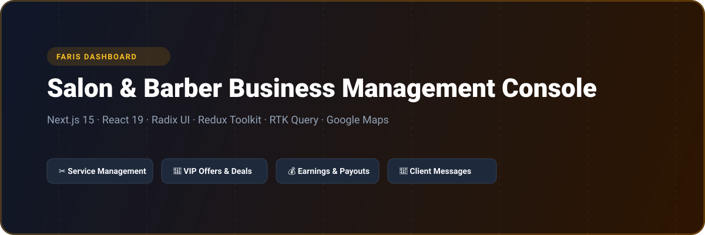
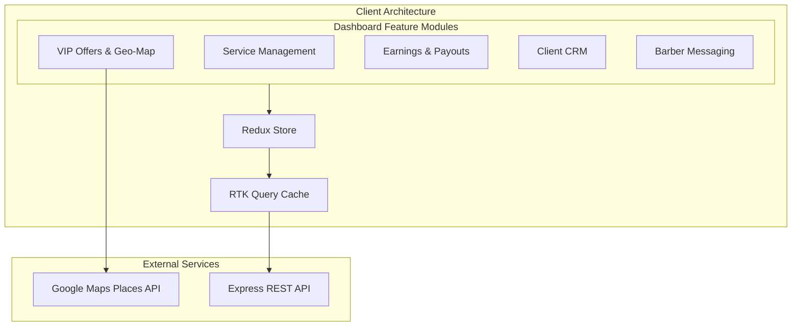

# Faris Dashboard - Salon & Barber Business Management Console

<p align="center">
  
</p>

<p align="center">
  <a href="https://nextjs.org"></a>
  <a href="https://react.dev"></a>
  <a href="https://redux-toolkit.js.org"></a>
  <a href="https://radix-ui.com"></a>
  <a href="https://tailwindcss.com"></a>
  <a href="LICENSE"></a>
</p>

---

## 📖 Overview

**Faris Dashboard (`faris_dashboard`)** is an enterprise administrative and vendor operations console tailored for luxury barbershops, beauty salons, and independent stylists. Powered by Next.js 15 App Router and React 19, the dashboard enables salon managers to oversee daily grooming services, launch exclusive VIP promotional offers, track revenue analytics and client appointments, chat with customers, and calibrate salon locations via Google Maps.

---

## ⚡ Key Features

- **✂️ Service Catalog & Pricing Modals:** Dynamic management for hair cuts, beard grooming, spa treatments, and duration settings.
- **💎 VIP Offer Campaign Engine:** Create and schedule time-limited VIP promotional tiers with interactive Google Maps geolocation targeting.
- **💰 Earnings & Financial Insights:** In-depth breakdown of gross appointments, net revenue, barber commission distributions, and payout histories.
- **👥 Client Management & Scheduling:** Comprehensive CRM tracking client profiles, visit frequencies, review histories, and re-booking cadences.
- **💬 Direct Barber-Client Chat:** Integrated messaging hub facilitating appointments coordination and pre-consultations.

---

## 🏗️ System Architecture



---

## 🗂️ Project Structure

```
faris_dashboard/
├── assets/
│   └── banner.svg               # Architectural repository banner
├── app/
│   ├── (auth)/                  # Login & password reset
│   ├── (dashboard)/
│   │   ├── business-management/ # Vendor operations & hours
│   │   ├── service-management/  # Add/edit grooming services
│   │   ├── vip-offer/           # VIP promotions & Maps
│   │   ├── earnings-management/ # Revenue & commission reports
│   │   ├── barber-messages/     # Real-time messaging hub
│   │   └── client-management/   # Customer records
│   ├── globals.css              # Tailwind CSS design tokens
│   └── layout.tsx
├── components/                  # Modals, charts, and tables
├── redux/                       # Redux store & RTK Query slices
├── package.json
└── tsconfig.json
```

---

## 🛠️ Tech Stack

| Technology | Purpose |
| :--- | :--- |
| **Next.js 15** | Server-side rendering and static dashboard layouts |
| **React 19** | Component framework and form state |
| **Redux Toolkit** | State management and API caching |
| **Google Maps API** | Location search and salon map pinning |
| **Radix UI** | Accessible modals, menus, and dropdowns |
| **Tailwind CSS v4** | Modern dark-themed styling |

---

## 🚀 Getting Started

### Prerequisites

- Node.js >= 20.0.0
- npm or yarn

### Installation

1. Clone the repository:
   ```bash
   git clone https://github.com/shahjalal-labs/faris_dashboard.git
   cd faris_dashboard
   ```

2. Install dependencies:
   ```bash
   npm install
   ```

3. Configure environment variables:
   ```bash
   cp .env.example .env.local
   ```

4. Start development server:
   ```bash
   npm run dev
   ```
   Open [http://localhost:3000](http://localhost:3000) to view the console.

---

## 📄 License

This project is licensed under the [ISC License](LICENSE).
